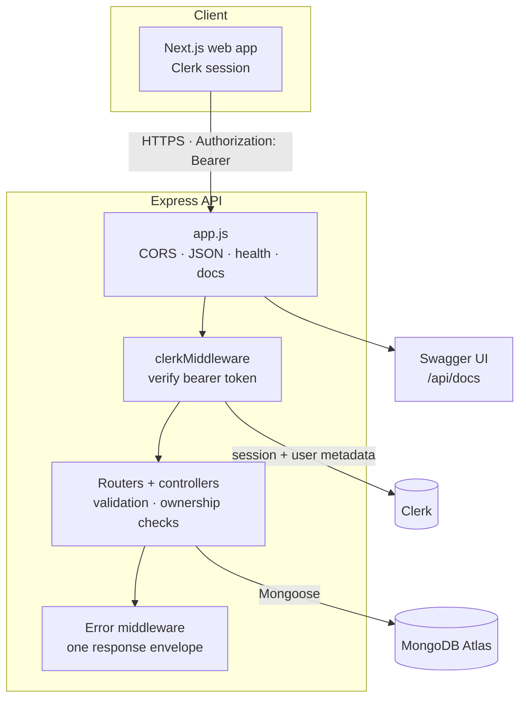
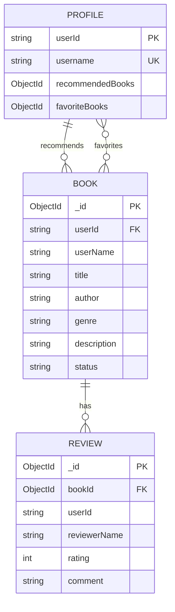
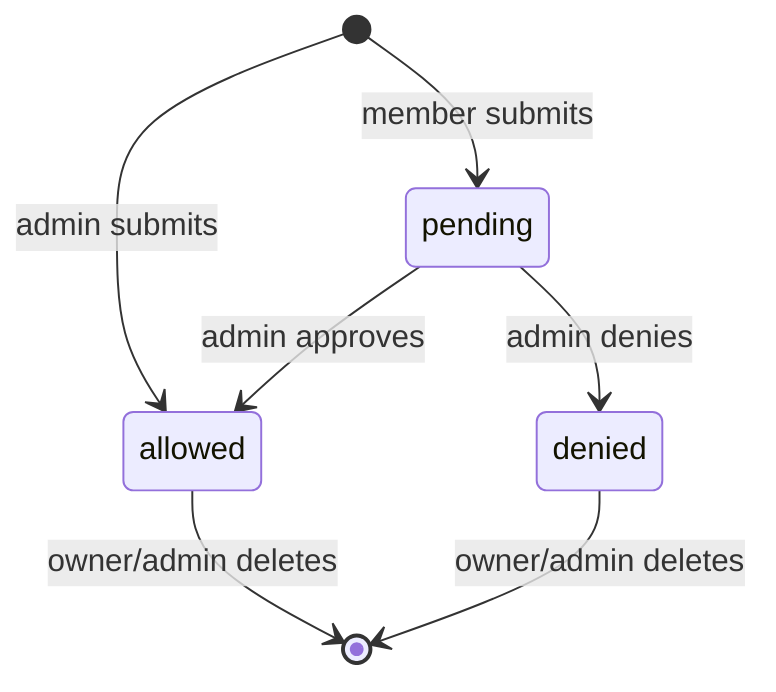

# The Book Heaven — Backend API

[](https://github.com/zakriayousafzai/the-book-heaven-backend/actions/workflows/ci.yml)


The REST API behind **[The Book Heaven](https://github.com/zakriayousafzai/the-book-heaven-frontend)** — a community-run, moderated library where readers recommend books, review them, and save a personal reading list.

This service owns the catalog, the moderation queue, reviews, favorites, and public profiles. It is built with **Node.js, Express, and MongoDB**, secured with **Clerk**, documented with **OpenAPI/Swagger**, covered by integration tests, and packaged for a one-command Docker start or a Render deploy.


*The Next.js client consuming this API. The screenshot uses sample library content.*

---

## What this API does

- **Public catalog** — paginated, approved-only book feed and literal search across title, author, genre, and description.
- **Moderation workflow** — member submissions start as `pending`; admins approve or deny them before they appear publicly.
- **Clerk authentication** — bearer-token verification, role resolution from session claims or Clerk public metadata, and admin guards.
- **Reviews & ratings** — 1–5 star reviews with edit/delete controls restricted to the author or an admin.
- **Favorites** — an idempotent, per-user reading list stored on the reader's profile.
- **Profiles** — public profiles show approved recommendations; the owner also sees pending books and approved favorites.
- **Ownership enforcement** — update/delete endpoints check the authenticated Clerk user before changing anything.
- **Consistent errors** — one `{ success: false, error, details? }` envelope for validation, auth, not-found, and server errors.
- **Living documentation** — Swagger UI at `/api/docs`, an OpenAPI 3.0 file, and an importable Postman collection.
- **Portfolio-grade delivery** — 54 integration tests, GitHub Actions CI, multi-stage Docker image, health probe, and deployment guide.

## Architecture



`app.js` builds the Express application without opening a port, which is what the test suite imports. `server.js` owns the process lifecycle: connect to MongoDB, listen, and shut down gracefully on `SIGINT`/`SIGTERM`.

## Tech stack

| Layer | Choice |
| --- | --- |
| Runtime | Node.js 22+ (ES modules) |
| HTTP | Express 4 |
| Database | MongoDB with Mongoose 8 |
| Auth | Clerk (`@clerk/express`) |
| Security | Helmet headers, CORS allowlist, JSON body limits |
| API docs | OpenAPI 3.0, Swagger UI, Postman |
| Tests | Node's built-in test runner, Supertest, `mongodb-memory-server` |
| Delivery | GitHub Actions, Docker, Docker Compose, Render blueprint |

---

## Quick start

### Prerequisites

- Node.js **22 or newer**
- npm
- A MongoDB database — local Docker or [MongoDB Atlas](https://www.mongodb.com/atlas)
- A [Clerk](https://clerk.com) application (publishable + secret keys)

### 1. Install and configure

```bash
git clone https://github.com/zakriayousafzai/the-book-heaven-backend.git
cd the-book-heaven-backend
npm install
cp .env.example .env
```

On Windows PowerShell, use `Copy-Item .env.example .env`.

Open `.env` and fill in `DB_URI`, `CLERK_PUBLISHABLE_KEY`, and
`CLERK_SECRET_KEY`. The full reference is below.

### 2. Start MongoDB

If you do not have MongoDB installed, run one in Docker:

```bash
docker run --name book-heaven-mongo -p 27017:27017 -d mongo:7
```

Or point `DB_URI` at an Atlas cluster.

### 3. Run the API

```bash
npm run dev
```

The API starts at **http://localhost:5000** (or your configured `PORT`).

```bash
curl http://localhost:5000/health
# {"success":true,"status":"ok","database":"connected",...}
```

Open **http://localhost:5000/api/docs** for interactive Swagger documentation.

### 4. Connect the frontend

In the [frontend repository](https://github.com/zakriayousafzai/the-book-heaven-frontend), set:

```text
NEXT_PUBLIC_API_URL=http://localhost:5000
```

For local development the API allows any origin when `CORS_ORIGIN` is empty.
`.env.example` ships with `CORS_ORIGIN=http://localhost:3000`; change it if
your frontend runs elsewhere.

## Environment variables

| Variable | Required | Default | Description |
| --- | --- | --- | --- |
| `PORT` | No | `5000` | HTTP port the API listens on |
| `NODE_ENV` | No | `development` | `production` hides internal 500 error messages |
| `DB_URI` | **Yes** | — | MongoDB connection string (local or Atlas) |
| `CLERK_PUBLISHABLE_KEY` | **Yes** | — | Clerk application publishable key |
| `CLERK_SECRET_KEY` | **Yes** | — | Clerk secret key — never commit it |
| `CORS_ORIGIN` | No | any origin | Comma-separated browser origins allowed to call the API |

`.env.example` is the tracked template. `.env*` is ignored by Git except for that
template.

## Scripts

| Command | What it does |
| --- | --- |
| `npm run dev` | Start with Nodemon and hot reload |
| `npm start` | Start the production server (`node server.js`) |
| `npm test` | Run the full integration suite |
| `npm run test:watch` | Re-run tests on file changes |
| `npm run docs:check` | Parse `docs/openapi.yaml` and validate references |

Tests use an in-memory MongoDB and injected Clerk identities, so they do **not**
need a real database or Clerk keys.

---

## API documentation

| Resource | Location |
| --- | --- |
| Interactive Swagger UI | `http://localhost:5000/api/docs` |
| OpenAPI 3.0 source | [`docs/openapi.yaml`](docs/openapi.yaml) |
| Machine-readable JSON | `http://localhost:5000/api/docs.json` |
| Postman collection | [`docs/postman/the-book-heaven.postman_collection.json`](docs/postman/the-book-heaven.postman_collection.json) |
| Postman setup notes | [`docs/postman/README.md`](docs/postman/README.md) |
| Deployment guide | [`docs/DEPLOYMENT.md`](docs/DEPLOYMENT.md) |

## API conventions

- **Base URL:** `http://localhost:5000` in development.
- **Content type:** JSON request and response bodies.
- **Authentication:** send a Clerk session token as `Authorization: Bearer <token>`.
- **IDs:** MongoDB ObjectIds. Malformed ids return `400`; missing/invisible resources return `404`.
- **Pagination:** collection endpoints accept `page` (1-based, default `1`) and `limit` (default `10`, max `100`).

Collection responses:

```json
{
  "data": [],
  "pagination": {
    "currentPage": 1,
    "totalPages": 0,
    "totalItems": 0,
    "limit": 10
  }
}
```

Error responses:

```json
{
  "success": false,
  "error": "Validation failed",
  "details": ["Path `rating` (6) is more than maximum allowed value (5)."]
}
```

`details` is present for validation and duplicate-key errors. Status codes used by
the API: `200`, `201`, `400`, `401`, `403`, `404`, `409`, `413`, and `500`.

## Endpoints

| Method | Endpoint | Access | Description |
| --- | --- | --- | --- |
| `GET` | `/health` | Public | Liveness probe with process uptime and DB state |
| `GET` | `/api/books?page=&limit=` | Public | Paginated, newest-first approved catalog |
| `GET` | `/api/books/search?q=` | Public | Literal search across title, author, genre, description |
| `GET` | `/api/books/:id` | Public / owner / admin | One book; unpublished books are hidden from the public |
| `POST` | `/api/books` | User | Recommend a book (member requests are `pending`) |
| `PUT` | `/api/books/:id` | Owner / admin | Edit title, author, genre, description |
| `DELETE` | `/api/books/:id` | Owner / admin | Delete a book, its reviews, and profile references |
| `GET` | `/api/books/:id/reviews?page=&limit=` | Public / owner / admin | Paginated reviews for a book |
| `POST` | `/api/books/:id/reviews` | User | Review an approved book |
| `PUT` | `/api/reviews/:id` | Author / admin | Edit rating and comment |
| `DELETE` | `/api/reviews/:id` | Author / admin | Delete a review |
| `GET` | `/api/favorite` | User | List the signed-in user's favorites |
| `POST` | `/api/favorite` | User | Add an approved book (idempotent) |
| `DELETE` | `/api/favorite/:bookId` | User | Remove a favorite |
| `GET` | `/api/users/:username` | Public / owner | Public profile; owner also sees pending books + favorites |
| `GET` | `/api/admin/books?status=` | Admin | Moderation queue (`pending`, `allowed`, `denied`) |
| `POST` | `/api/admin/books/:bookId/approve` | Admin | Publish a book |
| `POST` | `/api/admin/books/:bookId/deny` | Admin | Deny a book |

### Examples

```bash
BASE_URL=http://localhost:5000

# Health
curl -s "$BASE_URL/health"

# Browse the catalog
curl -s "$BASE_URL/api/books?page=1&limit=5"

# Search for a title, author, or genre
curl -s "$BASE_URL/api/books/search?q=pragmatic"

# Read a book and its reviews
curl -s "$BASE_URL/api/books/$BOOK_ID"
curl -s "$BASE_URL/api/books/$BOOK_ID/reviews?page=1&limit=10"
```

Authenticated requests use a Clerk session token:

```bash
TOKEN="<clerk-session-token>"

# Recommend a book (returns 201 and status "pending" for members)
curl -s -X POST "$BASE_URL/api/books" \
  -H "Authorization: Bearer $TOKEN" \
  -H "Content-Type: application/json" \
  -d '{
    "title": "The Pragmatic Programmer",
    "author": "Andrew Hunt, David Thomas",
    "genre": "Software Engineering",
    "description": "A practical guide to the habits and mindset behind good software."
  }'

# Save a favorite
curl -s -X POST "$BASE_URL/api/favorite" \
  -H "Authorization: Bearer $TOKEN" \
  -H "Content-Type: application/json" \
  -d "{\"bookId\":\"$BOOK_ID\"}"

# Review an approved book
curl -s -X POST "$BASE_URL/api/books/$BOOK_ID/reviews" \
  -H "Authorization: Bearer $TOKEN" \
  -H "Content-Type: application/json" \
  -d '{"rating":5,"comment":"One of those books I wish I had read earlier."}'
```

Admin moderation:

```bash
ADMIN_TOKEN="<clerk-session-token-for-an-admin>"

curl -s "$BASE_URL/api/admin/books?status=pending" \
  -H "Authorization: Bearer $ADMIN_TOKEN"

curl -s -X POST "$BASE_URL/api/admin/books/$BOOK_ID/approve" \
  -H "Authorization: Bearer $ADMIN_TOKEN"
```

---

## Data model



### Book

| Field | Type | Notes |
| --- | --- | --- |
| `_id` | ObjectId | Mongo document id |
| `userId` | String | Clerk user id of the recommender |
| `userName` | String | Recommender's display name |
| `title` | String | Required |
| `author` | String | Required |
| `genre` | String | Required |
| `description` | String | Required recommendation note |
| `status` | String | `allowed` \| `pending` \| `denied`; default `pending` |

### Review

| Field | Type | Notes |
| --- | --- | --- |
| `_id` | ObjectId | Mongo document id |
| `bookId` | ObjectId → Book | Required |
| `userId` | String | Clerk user id of the reviewer |
| `reviewerName` | String | Display name at review time |
| `rating` | Number | Integer 1–5 |
| `comment` | String | Required |
| `createdAt` / `updatedAt` | — | Not enabled on this schema |

### Profile

| Field | Type | Notes |
| --- | --- | --- |
| `_id` | ObjectId | Mongo document id |
| `userId` | String | Unique Clerk user id |
| `username` | String | Unique public handle |
| `recommendedBooks` | [ObjectId → Book] | Books the reader recommended |
| `favoriteBooks` | [ObjectId → Book] | The reader's saved list |

## Authentication, roles & moderation

Clerk is the identity provider. `clerkMiddleware()` verifies the bearer token on
every `/api/*` request; `requireAuth` and `requireAdmin` guard protected routes.
The admin role is read from `sessionClaims.metadata.role` first and falls back to
the Clerk user's `publicMetadata.role`.

Add an admin in the Clerk Dashboard:

```json
{ "role": "admin" }
```

**Authorization rules**

| Action | Who can do it |
| --- | --- |
| Read approved books, reviews, and profiles | Anyone |
| Read a pending/denied book or its reviews | Owner or admin |
| Create a recommendation | Signed-in user |
| Edit a recommendation | Owner or admin |
| Delete a recommendation | Owner or admin |
| Review an approved book | Signed-in user |
| Edit/delete a review | Author or admin |
| Manage favorites | The signed-in user only |
| Approve/deny books | Admin |

**Moderation lifecycle**



Only `allowed` books appear in the catalog, search, public profiles, and review
creation. Editing a book does **not** change its status; moderation is an explicit
admin action.

## Security notes

- **No mass assignment:** book updates accept only `title`, `author`, `genre`, and
  `description`; review updates accept only `rating` and `comment`. A member cannot
  set `status: "allowed"` or change `userId`.
- **IDOR protection:** update and delete handlers compare the stored `userId` with
  the authenticated Clerk id, with an admin override where intended.
- **Unpublished content stays private:** fetching a pending/denied book or its
  reviews by id returns `404` unless the caller is the owner or an admin.
- **Regex injection is neutralized:** search terms are escaped before building the
  Mongo query, and query length is capped at 200 characters.
- **Body size is bounded:** JSON bodies are limited to `1mb`.
- **CORS is configurable:** set `CORS_ORIGIN` to a comma-separated allowlist in
  production.
- **Security headers:** Helmet sets `nosniff`, frame denial, HSTS, and related
  headers. CSP is disabled so Swagger UI can load its inline bootstrap assets.
- **Errors do not leak internals:** production 500 responses return a generic
  message while detailed Mongoose/Clerk errors are logged server-side.
- **Secrets stay out of Git:** `.env*` is ignored except `.env.example`.

Not included (see roadmap): rate limiting, request-level tracing, WAF rules, and
image upload scanning. Add these at the edge or as a follow-up before a
high-traffic public launch.

---

## Testing & CI

```bash
npm test
```

The suite covers:

- public/owner/admin visibility for books and reviews
- authentication and admin-role guards
- recommendation creation and profile linking
- ownership checks on book and review mutations
- moderation approve/deny flows and status filtering
- favorites and profile behavior
- pagination, validation errors, malformed ids, and regex-safe search
- the health probe, 404 envelope, docs endpoint, and malformed JSON handling

Tests run against `mongodb-memory-server` and inject deterministic Clerk
identities via `createApp({ withClerk: false, authMiddleware })` — no real
credentials or network calls are required. The first run downloads a MongoDB test
binary and caches it; later runs start much faster.

The GitHub Actions workflow runs `npm ci`, validates the OpenAPI document, and
executes the suite on **Node 22 and Node 24** for every push to `main` and every
pull request.

## Docker & deployment

Local API + MongoDB:

```bash
# .env must contain CLERK_PUBLISHABLE_KEY and CLERK_SECRET_KEY
docker compose up --build
```

Production image:

```bash
docker build -t the-book-heaven-api .
docker run --rm -p 5000:5000 --env-file .env.production the-book-heaven-api
```

The image runs as the unprivileged `node` user, installs production dependencies
only, and includes a `HEALTHCHECK` against `/health`.

Deployment options covered in [`docs/DEPLOYMENT.md`](docs/DEPLOYMENT.md):

- **Render** — ready-made [`render.yaml`](render.yaml) blueprint with a health check
- **Railway** — Node service + env vars
- **Fly.io** — Docker deploy + HTTP health check
- **Docker** — any container host

The API is stateless and can scale horizontally. MongoDB Atlas handles persistence
and backups.

## Project structure

```text
the-book-heaven-backend/
├── app.js                       # Express app factory: middleware, routes, docs
├── server.js                    # DB connect, listen, graceful shutdown
├── config/
│   ├── db.js                    # Mongoose connection + disconnect
│   └── env.js                   # dotenv loading, port, CORS origins
├── controllers/
│   ├── admin.controller.js      # Moderation queue, approve, deny
│   ├── book.controller.js       # Catalog, recommendations, ownership checks
│   ├── profile.controller.js    # Profiles + favorites
│   ├── review.controller.js     # Reviews + ratings
│   └── search.controller.js     # Escaped, paginated search
├── middleware/
│   ├── auth.middleware.js       # Clerk identity, requireAuth, requireAdmin
│   ├── error.middleware.js      # Normalized error envelope
│   └── notFound.middleware.js   # JSON 404 handler
├── models/
│   ├── book.model.js
│   ├── profile.model.js
│   └── review.model.js
├── routes/
│   ├── admin.router.js
│   ├── book.router.js
│   ├── favorites.router.js
│   ├── profile.router.js
│   ├── review.router.js
│   └── search.router.js
├── utils/
│   ├── apiError.js              # Status-aware application error
│   ├── escapeRegex.js           # Literal search terms
│   ├── objectId.js              # Mongoose id validation
│   ├── pagination.js            # Shared page/limit parsing
│   └── pick.js                  # Update-field allowlists
├── docs/
│   ├── DEPLOYMENT.md
│   ├── openapi.yaml
│   ├── postman/
│   └── screenshots/home.webp
├── scripts/check-openapi.js     # CI docs validation
├── tests/
│   ├── helpers/
│   ├── health.test.js
│   ├── books.test.js
│   ├── reviews.test.js
│   ├── favorites-profile.test.js
│   ├── search.test.js
│   └── admin.test.js
├── .github/workflows/ci.yml
├── .env.example
├── .nvmrc
├── CONTRIBUTING.md
├── SECURITY.md
├── Dockerfile
├── docker-compose.yml
├── render.yaml
├── LICENSE
└── package.json
```

## Roadmap

Intentionally scoped for a portfolio project; the next production hardening steps
would be:

- rate limiting and abuse protection on write endpoints
- structured request logging, request ids, and OpenTelemetry traces
- Atlas Search when the catalog outgrows regex search
- a seed script for demos and local development
- contract tests shared with the frontend
- optional cover-image uploads (the frontend currently generates covers in CSS)

## Related repository

- **Frontend:** [zakriayousafzai/the-book-heaven-frontend](https://github.com/zakriayousafzai/the-book-heaven-frontend) — Next.js, React 19, Tailwind CSS, Clerk, Zustand

Contributions are welcome — see [`CONTRIBUTING.md`](CONTRIBUTING.md) and the
[`SECURITY.md`](SECURITY.md) policy for sensitive reports.

## License

[MIT](LICENSE) © 2026 Zakria Yousafzai
